# Wyniki

Wartość końcowa = średnia z ostatnich K epok; linia = mediana po ziarnach, pas = kwartyle; ✗n = rozbieżne ziarna (lista w failures.csv, razem 21). Tabele: summary.csv, runs.csv.

### `fig:simple:arch_heatmap_test_accuracy`

simple: accuracy (test) (mediana) w zależności od liczby warstw ukrytych $L$ i neuronów w warstwie $B$.

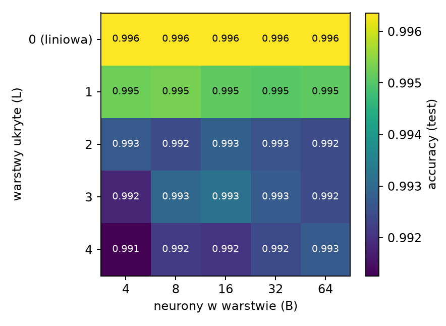

### `fig:simple:arch_lines_test_accuracy`

simple: accuracy (test) w zależności od $B$ dla każdej liczby warstw $L$ (mediana i kwartyle po ziarnach).

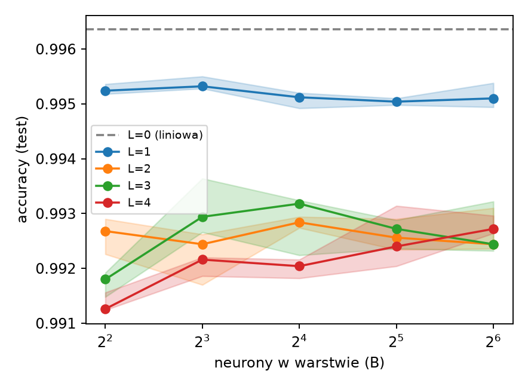

### `fig:simple:activation_lr_test_accuracy`

simple: accuracy (test) dla różnych funkcji aktywacji w zależności od współczynnika uczenia (mediana i kwartyle; liczba przy krzyżyku nad wykresem to liczba rozbieżnych ziaren).

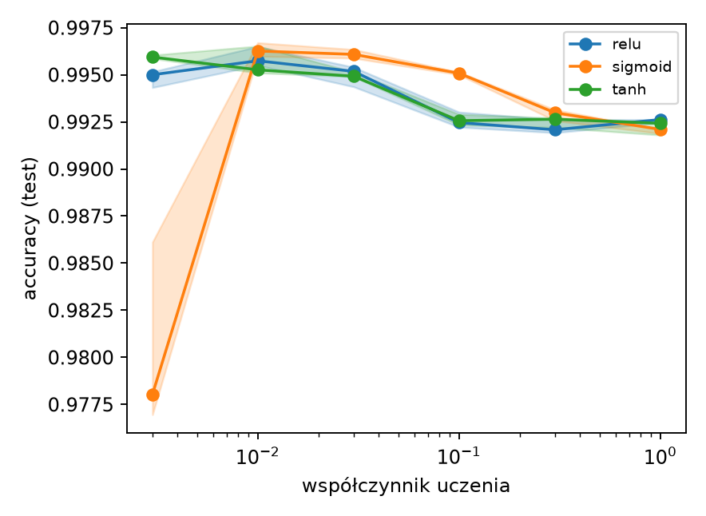

### `fig:simple:activation_lr_test_macro_f1`

simple: macro-F1 (test) dla różnych funkcji aktywacji w zależności od współczynnika uczenia (mediana i kwartyle; liczba przy krzyżyku nad wykresem to liczba rozbieżnych ziaren).

### `fig:simple:activation_curve_test_accuracy`

simple: przebieg accuracy (test) w trakcie uczenia dla różnych funkcji aktywacji (współczynnik uczenia 0.1).

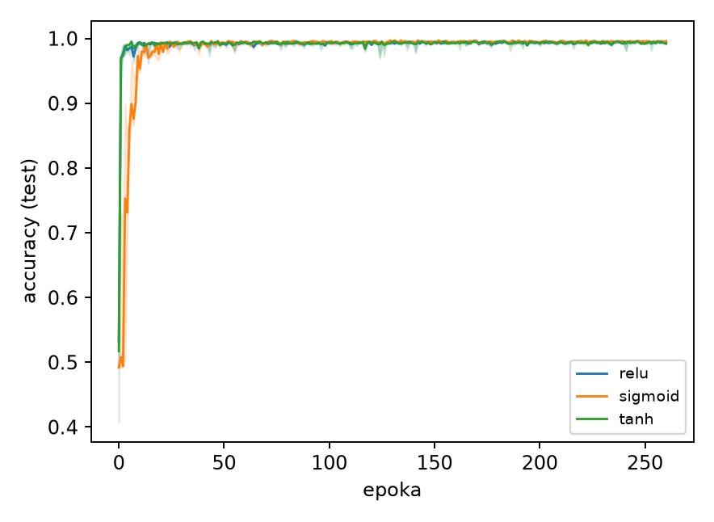

### `fig:simple:activation_curve_test_cost`

simple: przebieg koszt (test) w trakcie uczenia dla różnych funkcji aktywacji (współczynnik uczenia 0.1).

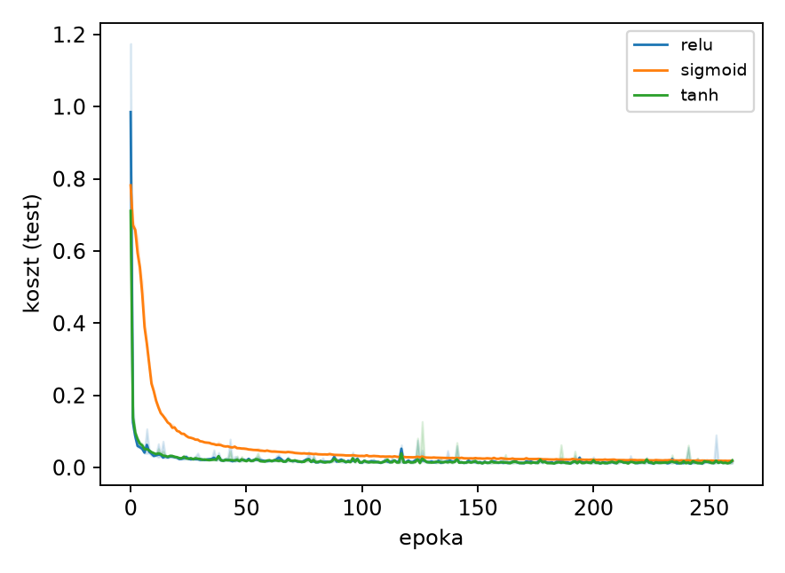

### `fig:simple:predictions_relu`

simple: obszary decyzyjne sieci z aktywacją relu (ziarno 0). Punkty testowe w kolorze prawdziwej klasy, × oznacza pomyłkę (accuracy 0.995).

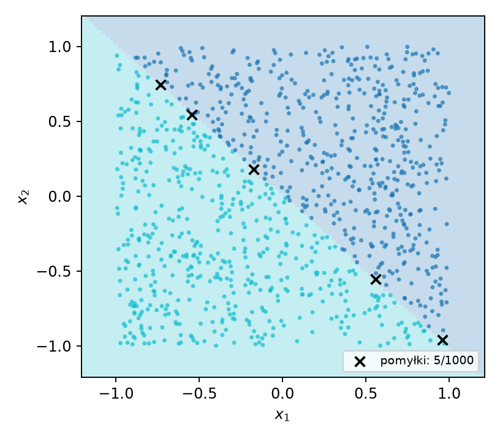

### `fig:simple:predictions_sigmoid`

simple: obszary decyzyjne sieci z aktywacją sigmoid (ziarno 0). Punkty testowe w kolorze prawdziwej klasy, × oznacza pomyłkę (accuracy 0.997).

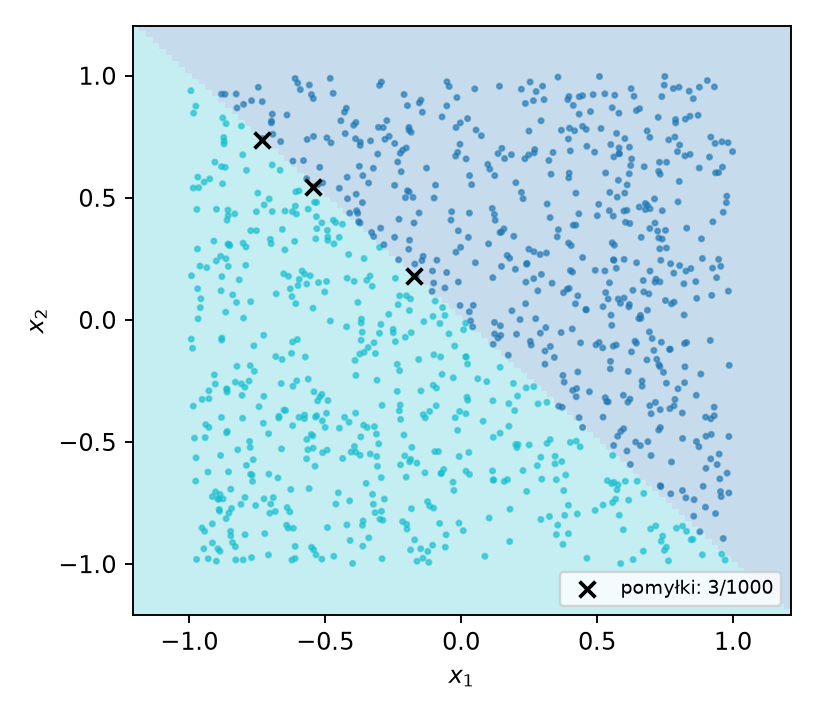

### `fig:simple:predictions_tanh`

simple: obszary decyzyjne sieci z aktywacją tanh (ziarno 0). Punkty testowe w kolorze prawdziwej klasy, × oznacza pomyłkę (accuracy 0.995).

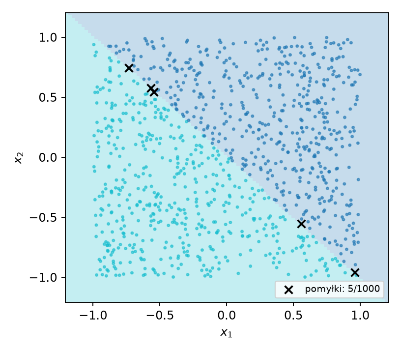

### `fig:simple:confusion_relu_32x32`

simple: macierz pomyłek na zbiorze testowym, aktywacja relu, architektura 32x32, suma po 5 ziarnach (accuracy 0.991).

### `fig:simple:confusion_sigmoid_32x32`

simple: macierz pomyłek na zbiorze testowym, aktywacja sigmoid, architektura 32x32, suma po 5 ziarnach (accuracy 0.996).

### `fig:simple:confusion_tanh_32x32`

simple: macierz pomyłek na zbiorze testowym, aktywacja tanh, architektura 32x32, suma po 5 ziarnach (accuracy 0.990).

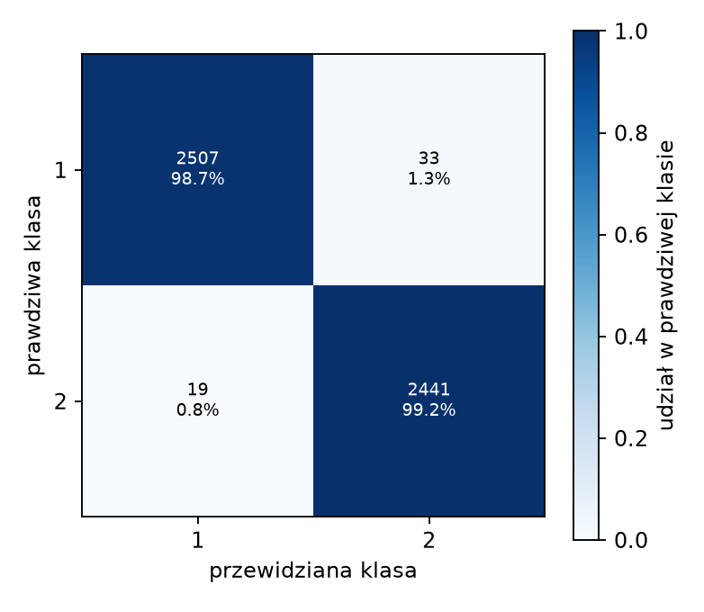

### `fig:simple:loss_lr_test_accuracy`

simple: accuracy (test) dla różnych funkcji kosztu w zależności od współczynnika uczenia (mediana i kwartyle; liczba przy krzyżyku nad wykresem to liczba rozbieżnych ziaren).

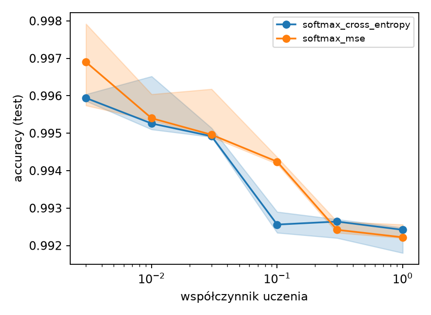

### `fig:simple:loss_lr_test_macro_f1`

simple: macro-F1 (test) dla różnych funkcji kosztu w zależności od współczynnika uczenia (mediana i kwartyle; liczba przy krzyżyku nad wykresem to liczba rozbieżnych ziaren).

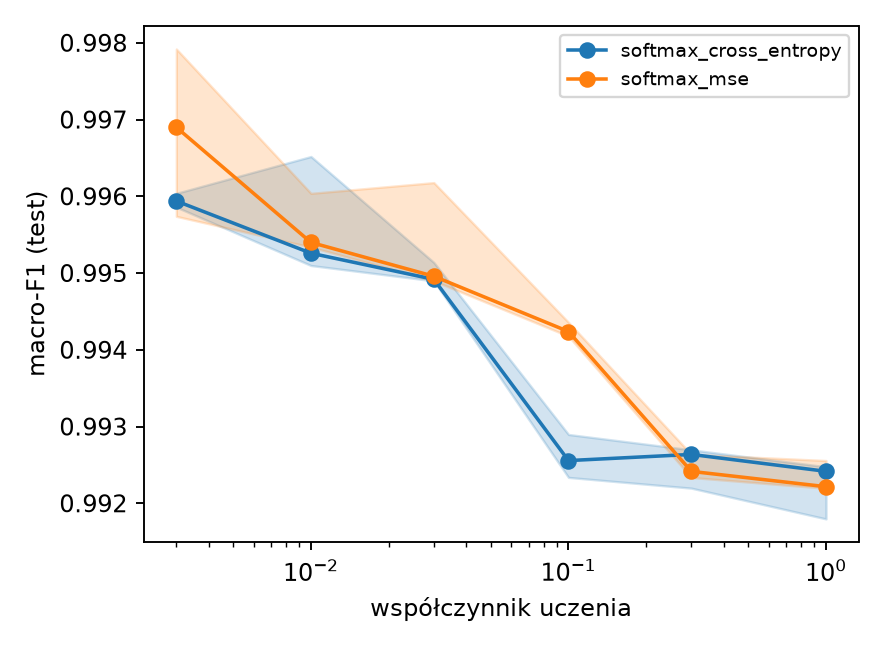

### `fig:simple:loss_curve_test_accuracy`

simple: przebieg accuracy (test) w trakcie uczenia dla różnych funkcji kosztu (współczynnik uczenia 0.1).

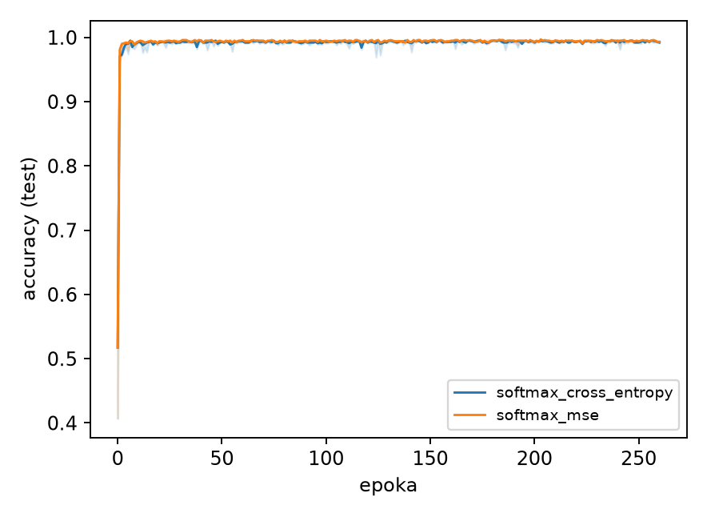

### `fig:simple:bias`

simple: accuracy (test) sieci z biasami i bez biasów.

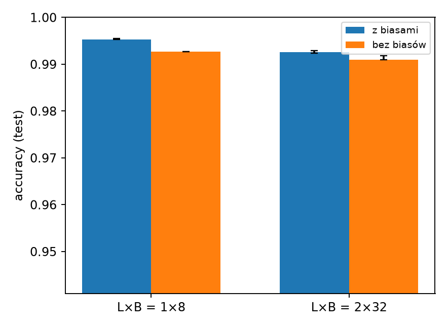

### `fig:three_gauss:arch_heatmap_test_accuracy`

three_gauss: accuracy (test) (mediana) w zależności od liczby warstw ukrytych $L$ i neuronów w warstwie $B$.

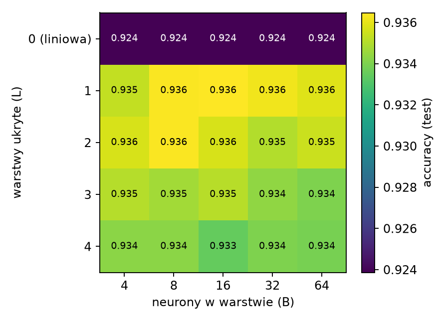

### `fig:three_gauss:arch_lines_test_accuracy`

three_gauss: accuracy (test) w zależności od $B$ dla każdej liczby warstw $L$ (mediana i kwartyle po ziarnach).

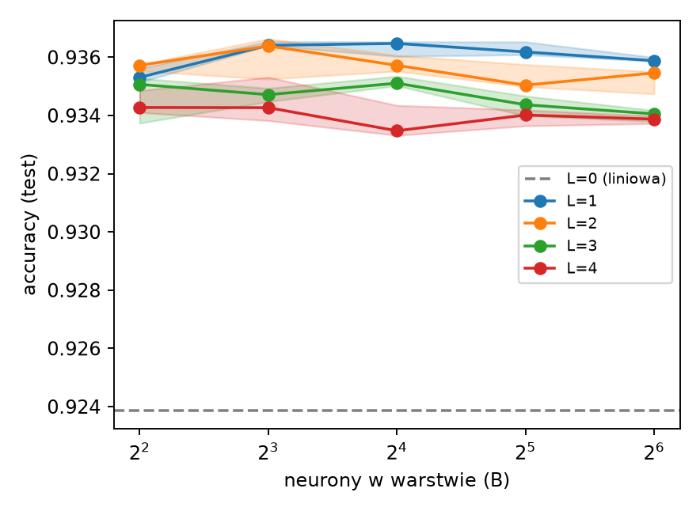

### `fig:three_gauss:activation_lr_test_accuracy`

three_gauss: accuracy (test) dla różnych funkcji aktywacji w zależności od współczynnika uczenia (mediana i kwartyle; liczba przy krzyżyku nad wykresem to liczba rozbieżnych ziaren).

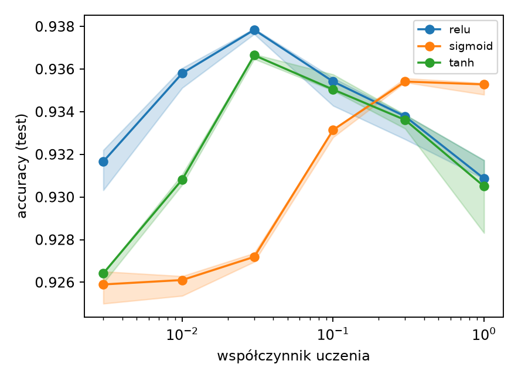

### `fig:three_gauss:activation_lr_test_macro_f1`

three_gauss: macro-F1 (test) dla różnych funkcji aktywacji w zależności od współczynnika uczenia (mediana i kwartyle; liczba przy krzyżyku nad wykresem to liczba rozbieżnych ziaren).

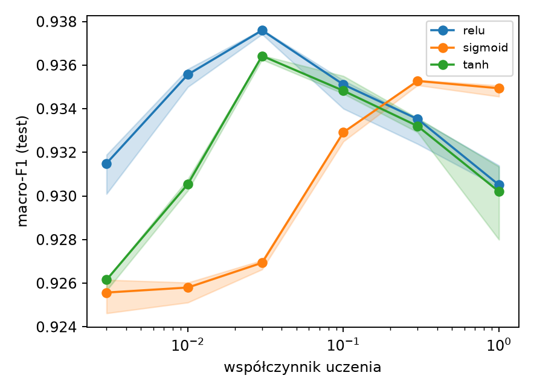

### `fig:three_gauss:activation_curve_test_accuracy`

three_gauss: przebieg accuracy (test) w trakcie uczenia dla różnych funkcji aktywacji (współczynnik uczenia 0.1).

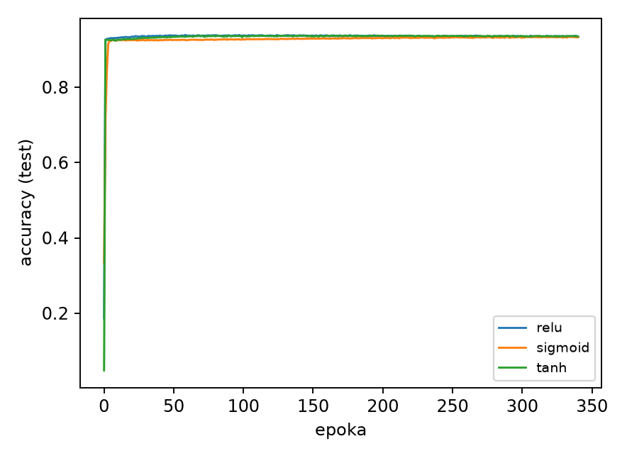

### `fig:three_gauss:activation_curve_test_cost`

three_gauss: przebieg koszt (test) w trakcie uczenia dla różnych funkcji aktywacji (współczynnik uczenia 0.1).

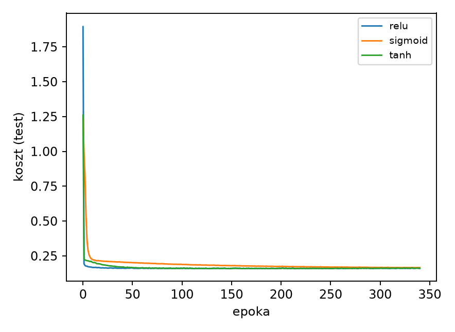

### `fig:three_gauss:predictions_relu`

three_gauss: obszary decyzyjne sieci z aktywacją relu (ziarno 0). Punkty testowe w kolorze prawdziwej klasy, × oznacza pomyłkę (accuracy 0.933).

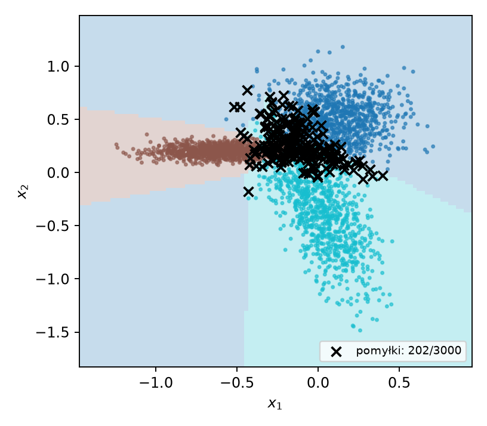

### `fig:three_gauss:predictions_sigmoid`

three_gauss: obszary decyzyjne sieci z aktywacją sigmoid (ziarno 0). Punkty testowe w kolorze prawdziwej klasy, × oznacza pomyłkę (accuracy 0.932).

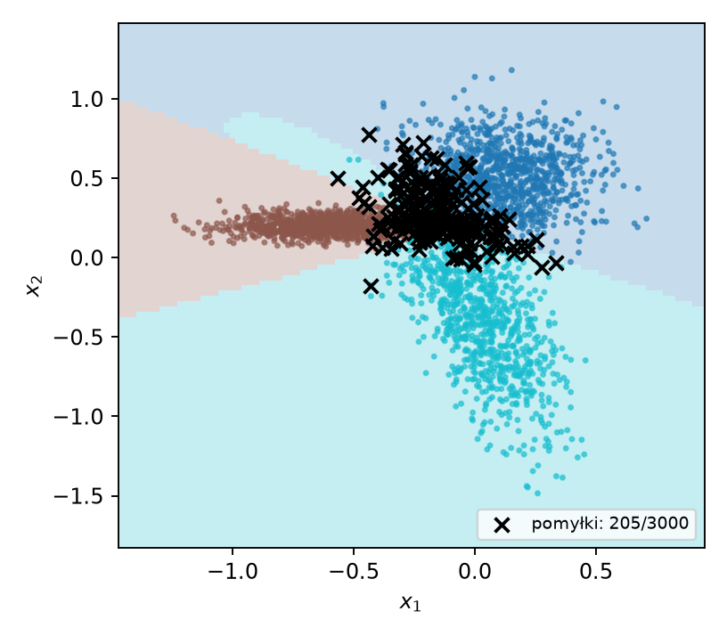

### `fig:three_gauss:predictions_tanh`

three_gauss: obszary decyzyjne sieci z aktywacją tanh (ziarno 0). Punkty testowe w kolorze prawdziwej klasy, × oznacza pomyłkę (accuracy 0.933).

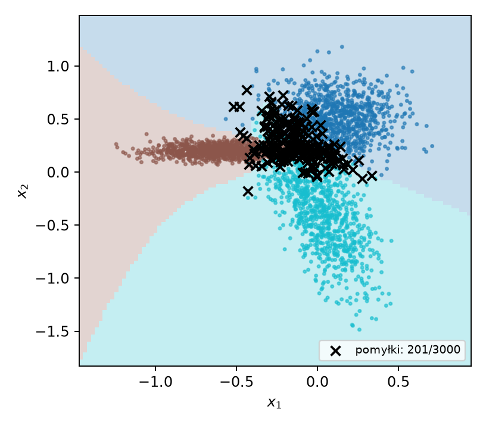

### `fig:three_gauss:confusion_relu_32x32`

three_gauss: macierz pomyłek na zbiorze testowym, aktywacja relu, architektura 32x32, suma po 5 ziarnach (accuracy 0.934).

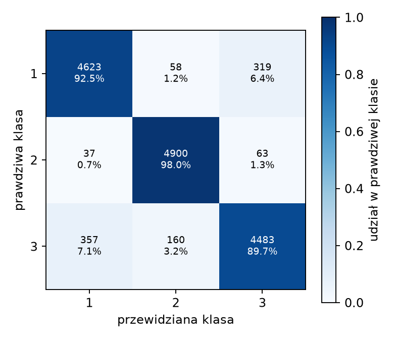

### `fig:three_gauss:confusion_sigmoid_32x32`

three_gauss: macierz pomyłek na zbiorze testowym, aktywacja sigmoid, architektura 32x32, suma po 5 ziarnach (accuracy 0.933).

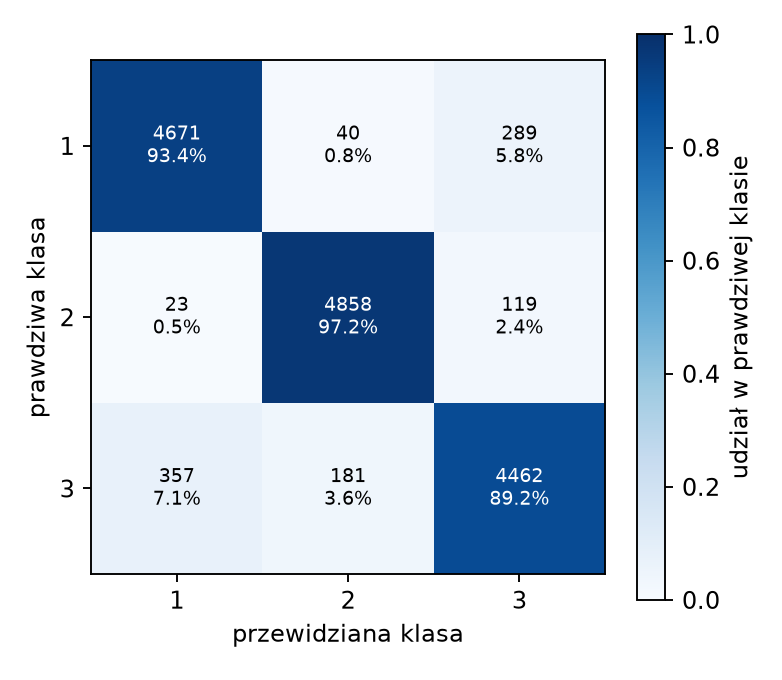

### `fig:three_gauss:confusion_tanh_32x32`

three_gauss: macierz pomyłek na zbiorze testowym, aktywacja tanh, architektura 32x32, suma po 5 ziarnach (accuracy 0.935).

### `fig:three_gauss:loss_lr_test_accuracy`

three_gauss: accuracy (test) dla różnych funkcji kosztu w zależności od współczynnika uczenia (mediana i kwartyle; liczba przy krzyżyku nad wykresem to liczba rozbieżnych ziaren).

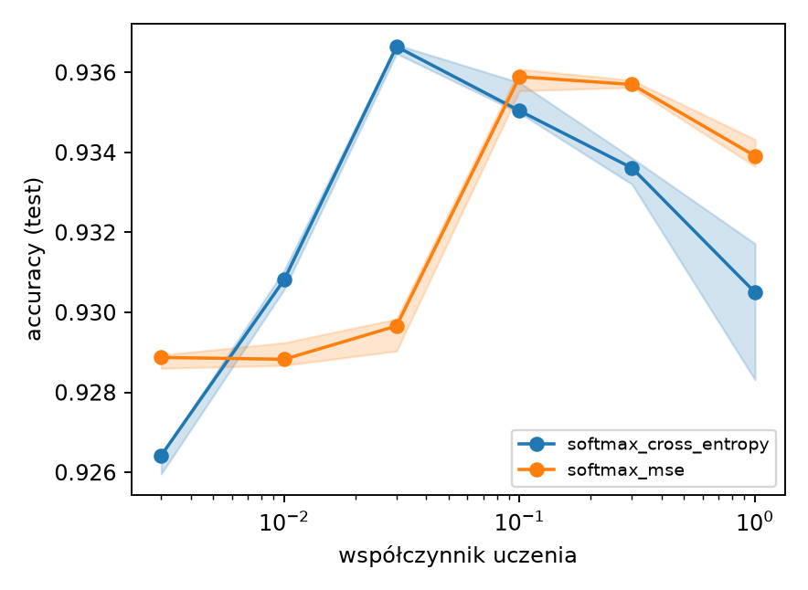

### `fig:three_gauss:loss_lr_test_macro_f1`

three_gauss: macro-F1 (test) dla różnych funkcji kosztu w zależności od współczynnika uczenia (mediana i kwartyle; liczba przy krzyżyku nad wykresem to liczba rozbieżnych ziaren).

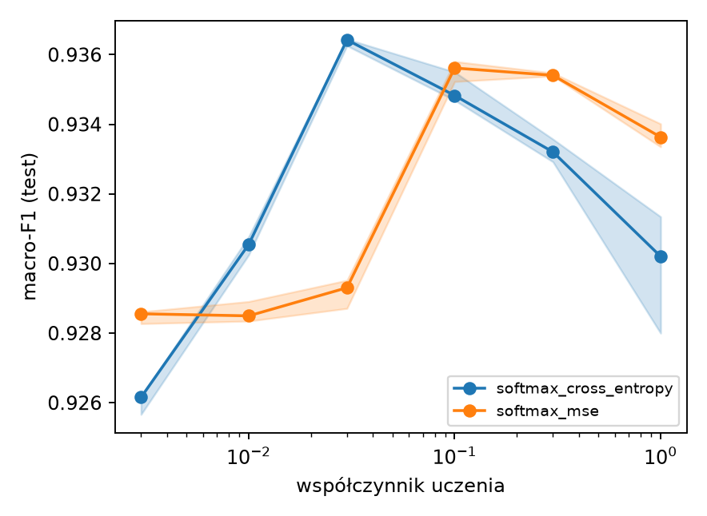

### `fig:three_gauss:loss_curve_test_accuracy`

three_gauss: przebieg accuracy (test) w trakcie uczenia dla różnych funkcji kosztu (współczynnik uczenia 0.1).

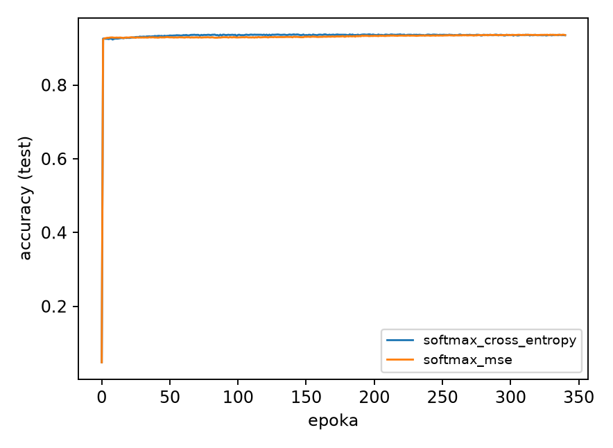

### `fig:three_gauss:bias`

three_gauss: accuracy (test) sieci z biasami i bez biasów.

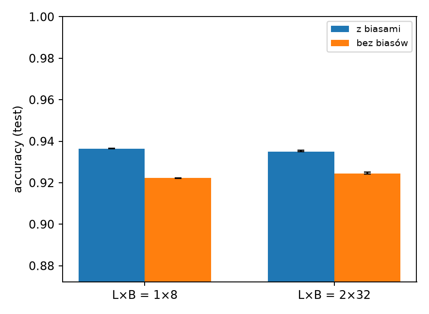

### `fig:cube:arch_heatmap_test_in_mse`

cube: MSE (test w zakresie uczenia) (mediana) w zależności od liczby warstw ukrytych $L$ i neuronów w warstwie $B$.

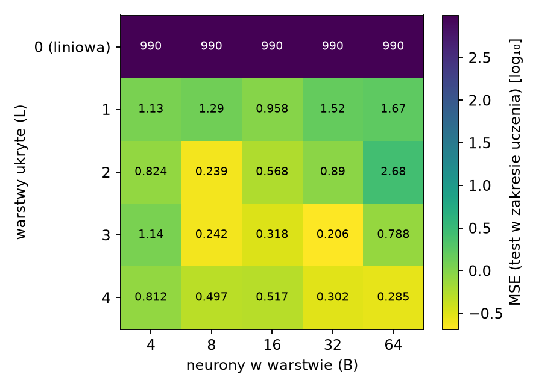

### `fig:cube:arch_lines_test_in_mse`

cube: MSE (test w zakresie uczenia) w zależności od $B$ dla każdej liczby warstw $L$ (mediana i kwartyle po ziarnach).

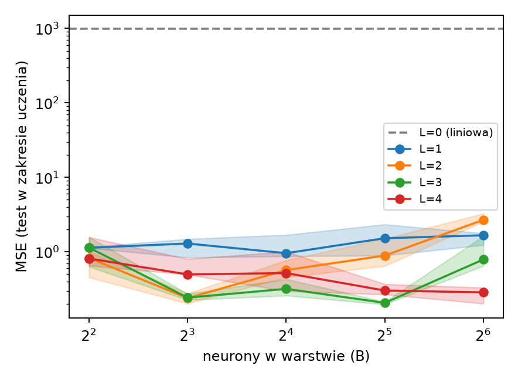

### `fig:cube:arch_heatmap_test_out_mse`

cube: MSE (test poza zakresem, ekstrapolacja) (mediana) w zależności od liczby warstw ukrytych $L$ i neuronów w warstwie $B$.

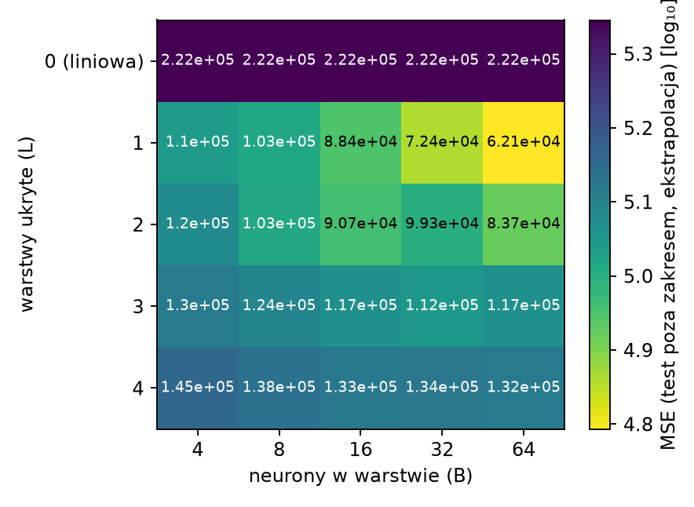

### `fig:cube:arch_lines_test_out_mse`

cube: MSE (test poza zakresem, ekstrapolacja) w zależności od $B$ dla każdej liczby warstw $L$ (mediana i kwartyle po ziarnach).

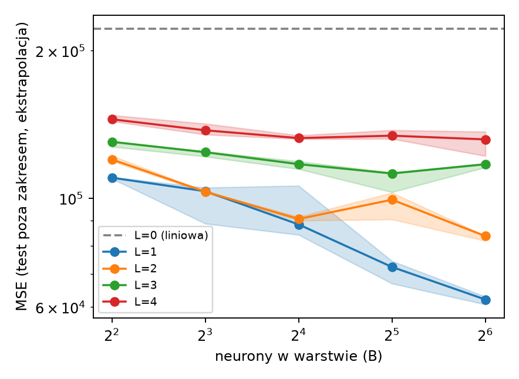

### `fig:cube:activation_lr_test_in_mse`

cube: MSE (test w zakresie uczenia) dla różnych funkcji aktywacji w zależności od współczynnika uczenia (mediana i kwartyle; liczba przy krzyżyku nad wykresem to liczba rozbieżnych ziaren).

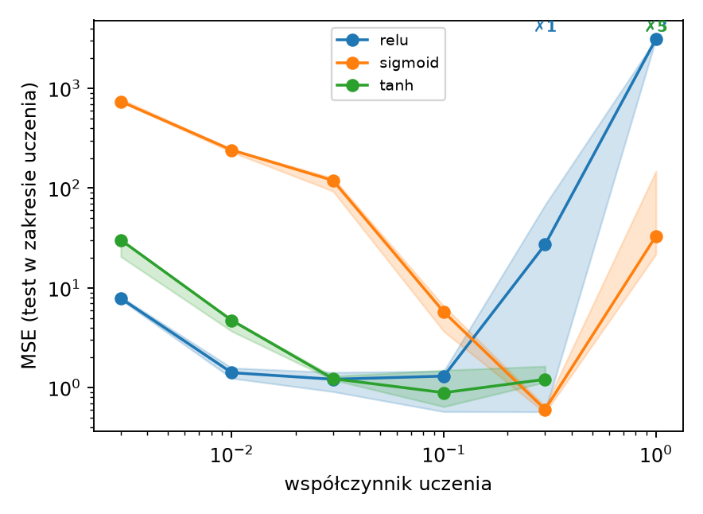

### `fig:cube:activation_lr_test_out_mse`

cube: MSE (test poza zakresem, ekstrapolacja) dla różnych funkcji aktywacji w zależności od współczynnika uczenia (mediana i kwartyle; liczba przy krzyżyku nad wykresem to liczba rozbieżnych ziaren).

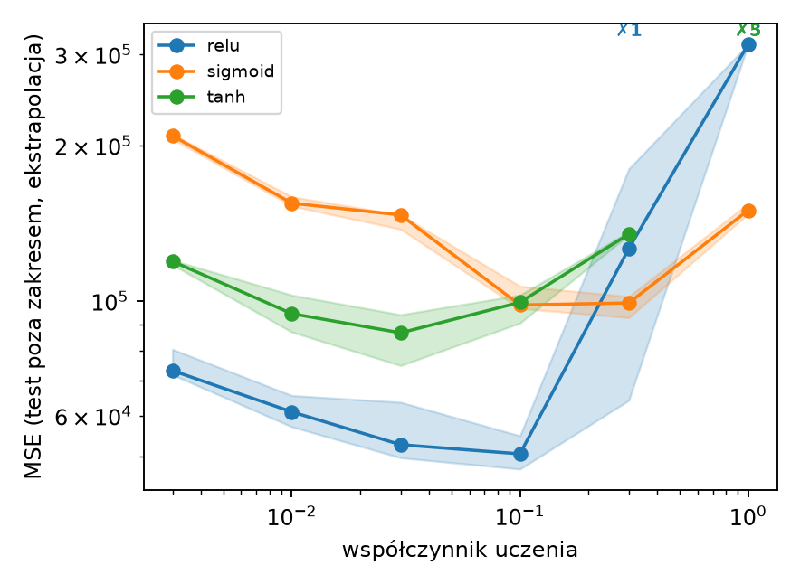

### `fig:cube:activation_curve_test_in_mse`

cube: przebieg MSE (test w zakresie uczenia) w trakcie uczenia dla różnych funkcji aktywacji (współczynnik uczenia 0.1).

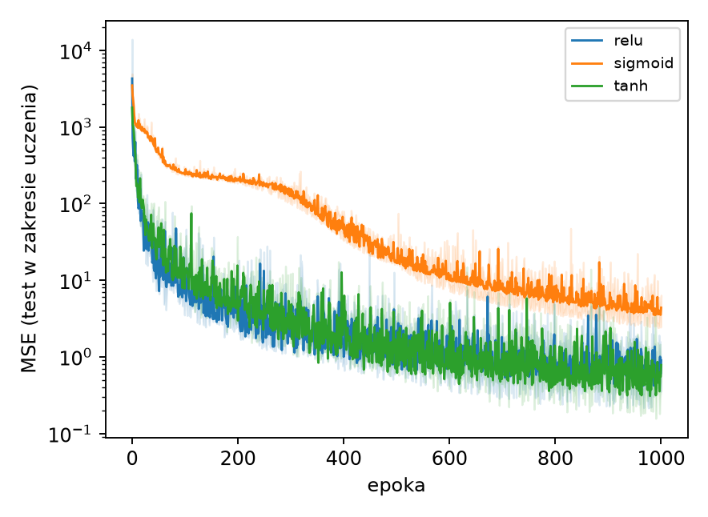

### `fig:cube:predictions_relu`

cube: funkcja nauczona przez sieć z aktywacją relu (ziarno 0) na całym zakresie testu; zielone tło to zakres danych uczących.

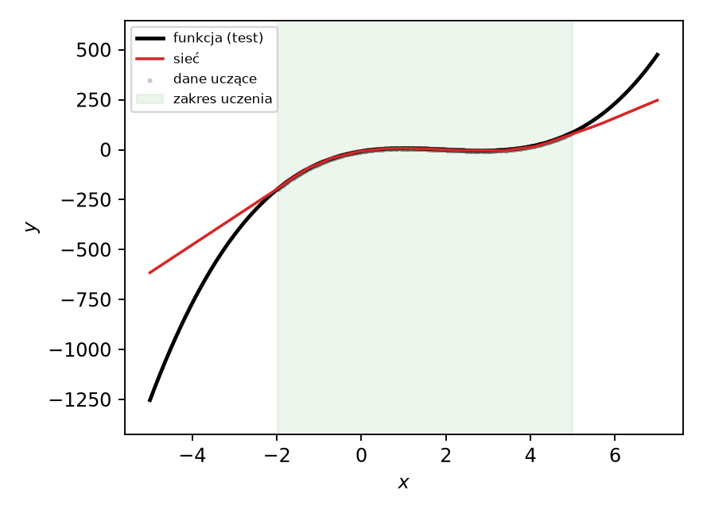

### `fig:cube:predictions_sigmoid`

cube: funkcja nauczona przez sieć z aktywacją sigmoid (ziarno 0) na całym zakresie testu; zielone tło to zakres danych uczących.

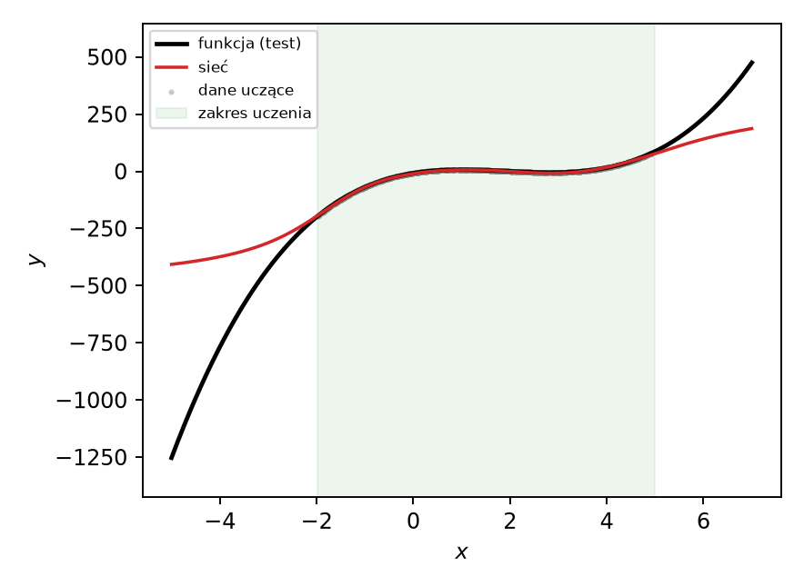

### `fig:cube:predictions_tanh`

cube: funkcja nauczona przez sieć z aktywacją tanh (ziarno 0) na całym zakresie testu; zielone tło to zakres danych uczących.

### `fig:cube:loss_lr_test_in_mse`

cube: MSE (test w zakresie uczenia) dla różnych funkcji kosztu w zależności od współczynnika uczenia (mediana i kwartyle; liczba przy krzyżyku nad wykresem to liczba rozbieżnych ziaren).

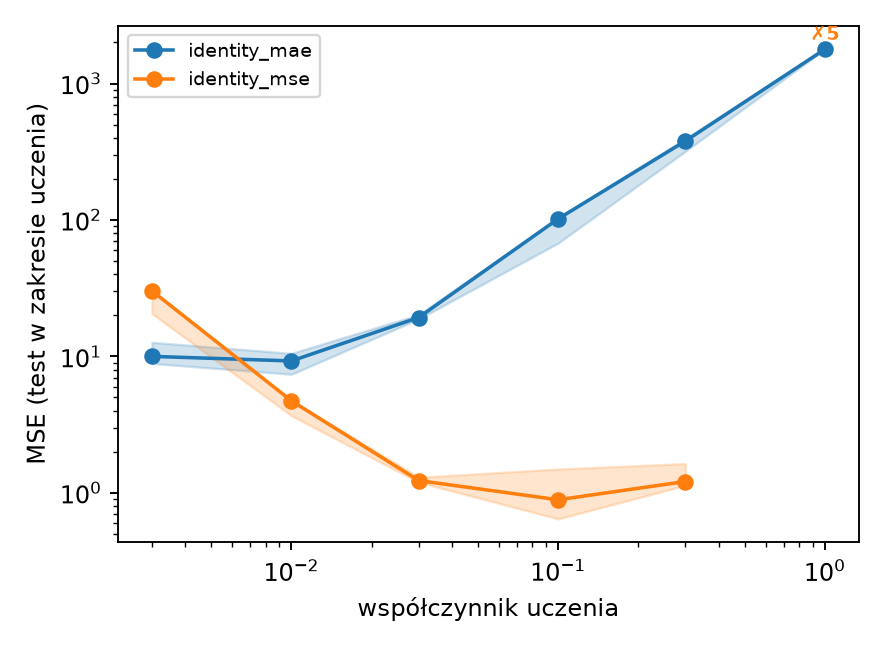

### `fig:cube:loss_lr_test_in_mae`

cube: MAE (test w zakresie uczenia) dla różnych funkcji kosztu w zależności od współczynnika uczenia (mediana i kwartyle; liczba przy krzyżyku nad wykresem to liczba rozbieżnych ziaren).

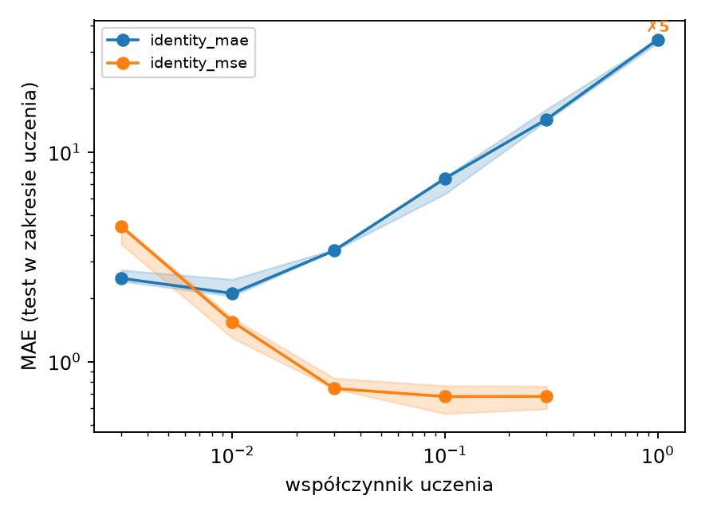

### `fig:cube:loss_curve_test_in_mse`

cube: przebieg MSE (test w zakresie uczenia) w trakcie uczenia dla różnych funkcji kosztu (współczynnik uczenia 0.1).

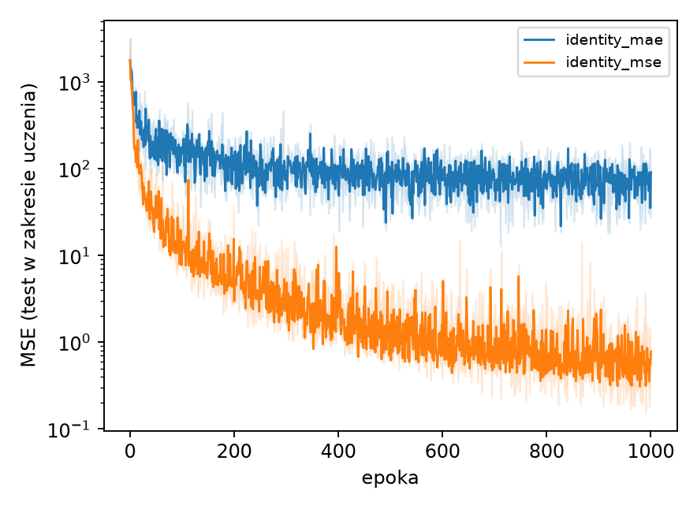

### `fig:cube:bias`

cube: MSE (test w zakresie uczenia) sieci z biasami i bez biasów.

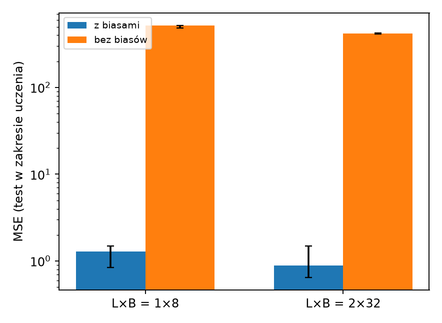

### `fig:activation:arch_heatmap_test_in_mse`

activation: MSE (test w zakresie uczenia) (mediana) w zależności od liczby warstw ukrytych $L$ i neuronów w warstwie $B$.

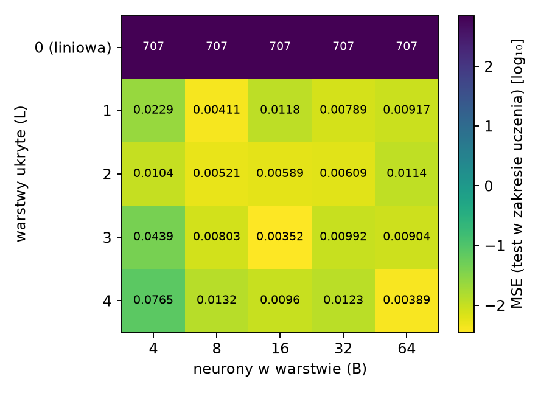

### `fig:activation:arch_lines_test_in_mse`

activation: MSE (test w zakresie uczenia) w zależności od $B$ dla każdej liczby warstw $L$ (mediana i kwartyle po ziarnach).

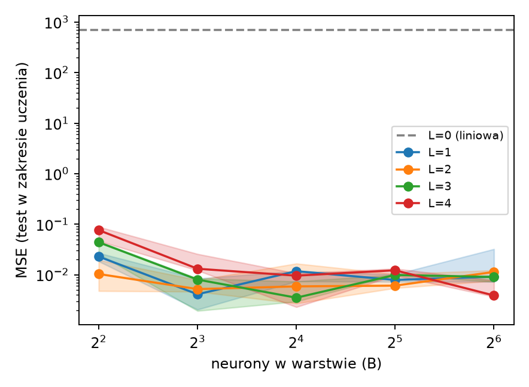

### `fig:activation:arch_heatmap_test_out_mse`

activation: MSE (test poza zakresem, ekstrapolacja) (mediana) w zależności od liczby warstw ukrytych $L$ i neuronów w warstwie $B$.

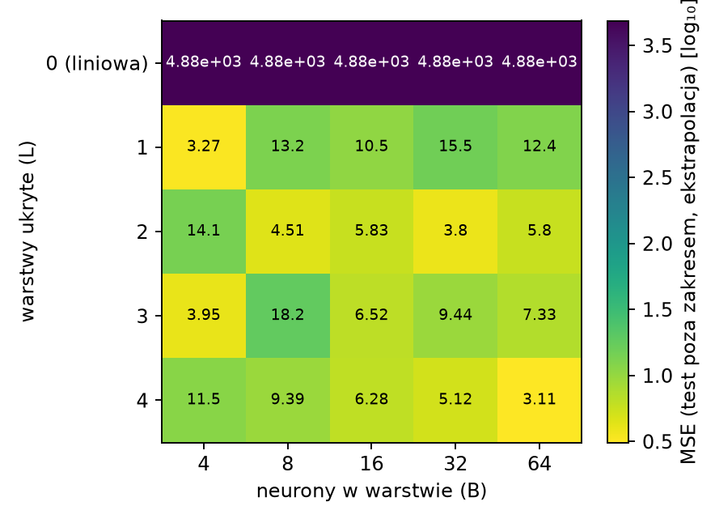

### `fig:activation:arch_lines_test_out_mse`

activation: MSE (test poza zakresem, ekstrapolacja) w zależności od $B$ dla każdej liczby warstw $L$ (mediana i kwartyle po ziarnach).

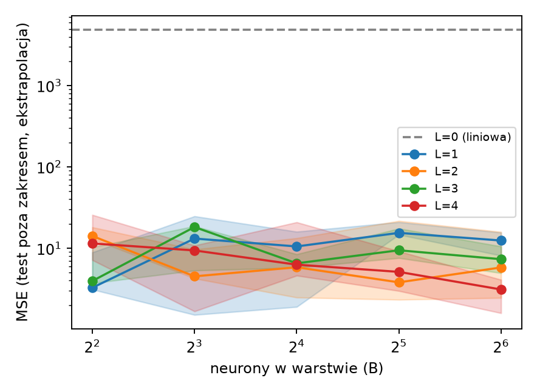

### `fig:activation:activation_lr_test_in_mse`

activation: MSE (test w zakresie uczenia) dla różnych funkcji aktywacji w zależności od współczynnika uczenia (mediana i kwartyle; liczba przy krzyżyku nad wykresem to liczba rozbieżnych ziaren).

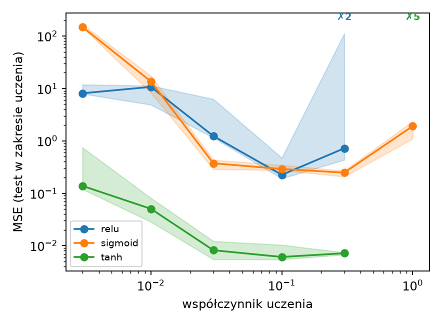

### `fig:activation:activation_lr_test_out_mse`

activation: MSE (test poza zakresem, ekstrapolacja) dla różnych funkcji aktywacji w zależności od współczynnika uczenia (mediana i kwartyle; liczba przy krzyżyku nad wykresem to liczba rozbieżnych ziaren).

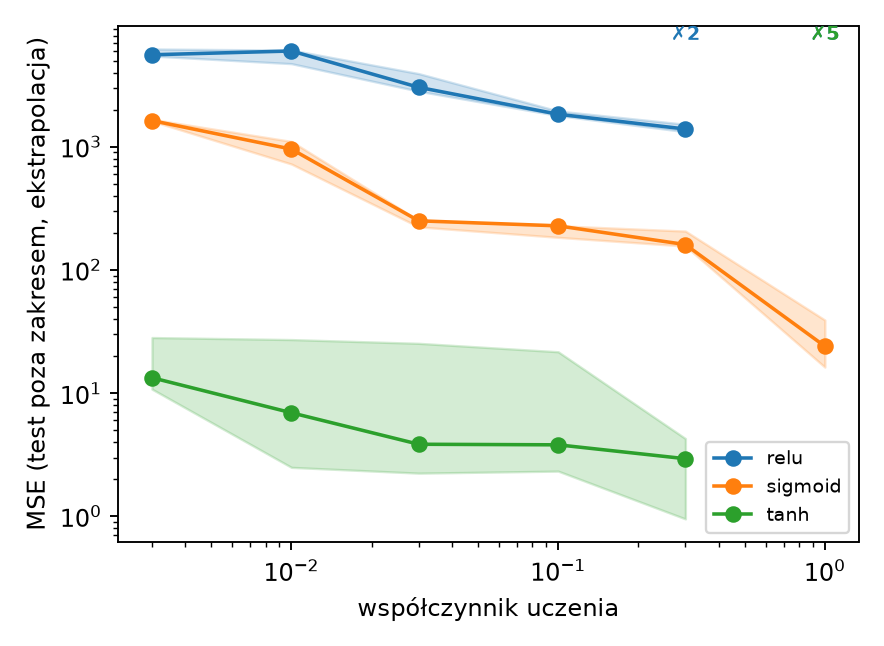

### `fig:activation:activation_curve_test_in_mse`

activation: przebieg MSE (test w zakresie uczenia) w trakcie uczenia dla różnych funkcji aktywacji (współczynnik uczenia 0.1).

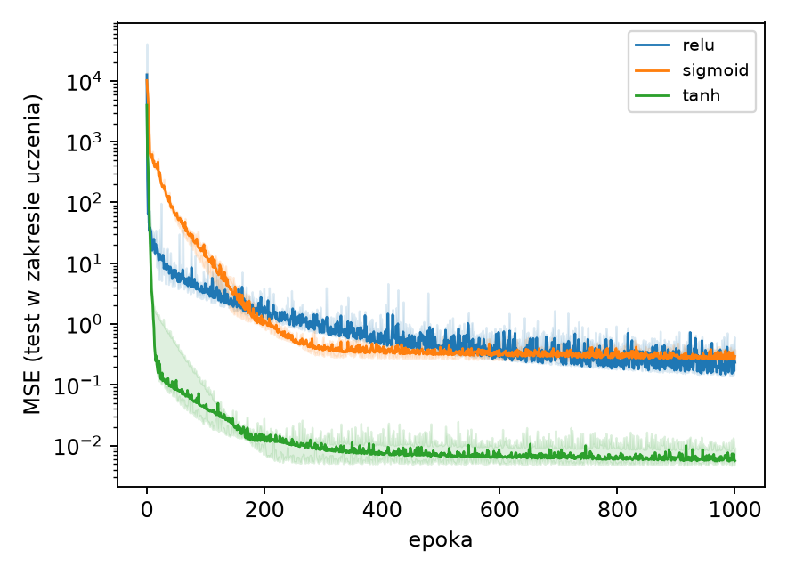

### `fig:activation:predictions_relu`

activation: funkcja nauczona przez sieć z aktywacją relu (ziarno 0) na całym zakresie testu; zielone tło to zakres danych uczących.

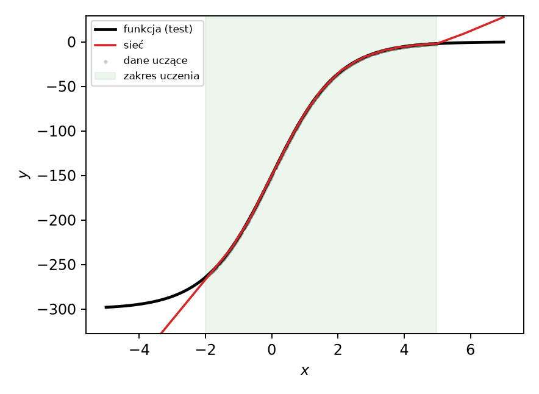

### `fig:activation:predictions_sigmoid`

activation: funkcja nauczona przez sieć z aktywacją sigmoid (ziarno 0) na całym zakresie testu; zielone tło to zakres danych uczących.

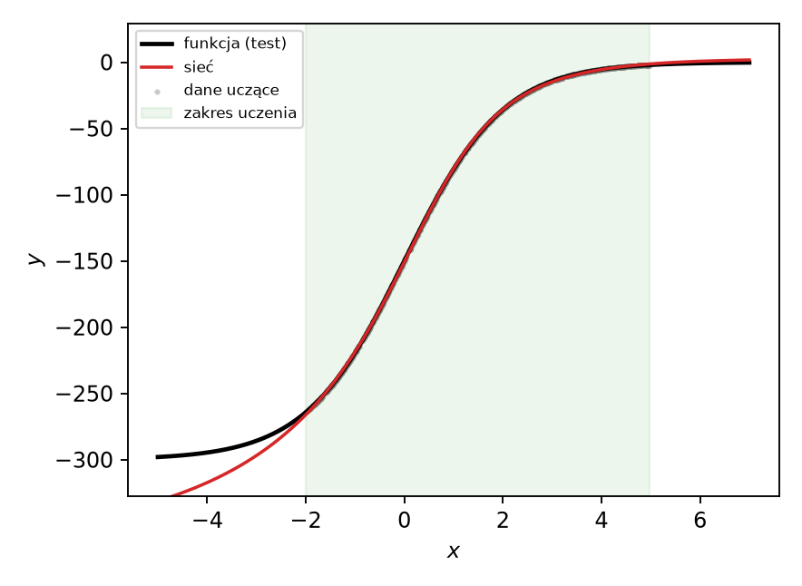

### `fig:activation:predictions_tanh`

activation: funkcja nauczona przez sieć z aktywacją tanh (ziarno 0) na całym zakresie testu; zielone tło to zakres danych uczących.

### `fig:activation:loss_lr_test_in_mse`

activation: MSE (test w zakresie uczenia) dla różnych funkcji kosztu w zależności od współczynnika uczenia (mediana i kwartyle; liczba przy krzyżyku nad wykresem to liczba rozbieżnych ziaren).

### `fig:activation:loss_lr_test_in_mae`

activation: MAE (test w zakresie uczenia) dla różnych funkcji kosztu w zależności od współczynnika uczenia (mediana i kwartyle; liczba przy krzyżyku nad wykresem to liczba rozbieżnych ziaren).

### `fig:activation:loss_curve_test_in_mse`

activation: przebieg MSE (test w zakresie uczenia) w trakcie uczenia dla różnych funkcji kosztu (współczynnik uczenia 0.1).

### `fig:activation:bias`

activation: MSE (test w zakresie uczenia) sieci z biasami i bez biasów.

### `fig:mnist:arch_heatmap_test_accuracy`

MNIST: accuracy (test) (mediana) w zależności od liczby warstw ukrytych $L$ i neuronów w warstwie $B$.

### `fig:mnist:arch_lines_test_accuracy`

MNIST: accuracy (test) w zależności od $B$ dla każdej liczby warstw $L$ (mediana i kwartyle po ziarnach).

### `fig:mnist:time_per_epoch`

MNIST: czas jednej epoki (uczenie i ewaluacja, jeden wątek) w zależności od architektury.

### `fig:mnist:activation_lr_test_accuracy`

MNIST: accuracy (test) dla różnych funkcji aktywacji w zależności od współczynnika uczenia (mediana i kwartyle; liczba przy krzyżyku nad wykresem to liczba rozbieżnych ziaren).

### `fig:mnist:activation_lr_test_macro_f1`

MNIST: macro-F1 (test) dla różnych funkcji aktywacji w zależności od współczynnika uczenia (mediana i kwartyle; liczba przy krzyżyku nad wykresem to liczba rozbieżnych ziaren).

### `fig:mnist:activation_curve_test_accuracy`

MNIST: przebieg accuracy (test) w trakcie uczenia dla różnych funkcji aktywacji (współczynnik uczenia 0.1).

### `fig:mnist:activation_curve_test_cost`

MNIST: przebieg koszt (test) w trakcie uczenia dla różnych funkcji aktywacji (współczynnik uczenia 0.1).

### `fig:mnist:confusion_relu_128`

MNIST: macierz pomyłek na zbiorze testowym, aktywacja relu, architektura 128, suma po 5 ziarnach (accuracy 0.979).

### `fig:mnist:confusion_sigmoid_128`

MNIST: macierz pomyłek na zbiorze testowym, aktywacja sigmoid, architektura 128, suma po 5 ziarnach (accuracy 0.961).

### `fig:mnist:confusion_tanh_128`

MNIST: macierz pomyłek na zbiorze testowym, aktywacja tanh, architektura 128, suma po 5 ziarnach (accuracy 0.977).

### `fig:mnist:loss_lr_test_accuracy`

MNIST: accuracy (test) dla różnych funkcji kosztu w zależności od współczynnika uczenia (mediana i kwartyle; liczba przy krzyżyku nad wykresem to liczba rozbieżnych ziaren).

### `fig:mnist:loss_lr_test_macro_f1`

MNIST: macro-F1 (test) dla różnych funkcji kosztu w zależności od współczynnika uczenia (mediana i kwartyle; liczba przy krzyżyku nad wykresem to liczba rozbieżnych ziaren).

### `fig:mnist:loss_curve_test_accuracy`

MNIST: przebieg accuracy (test) w trakcie uczenia dla różnych funkcji kosztu (współczynnik uczenia 0.1).

### `fig:mnist:bias`

MNIST: accuracy (test) sieci z biasami i bez biasów.

