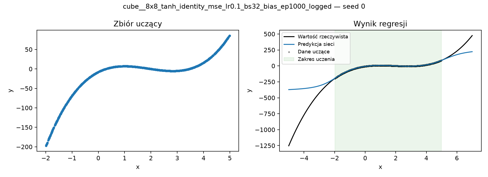
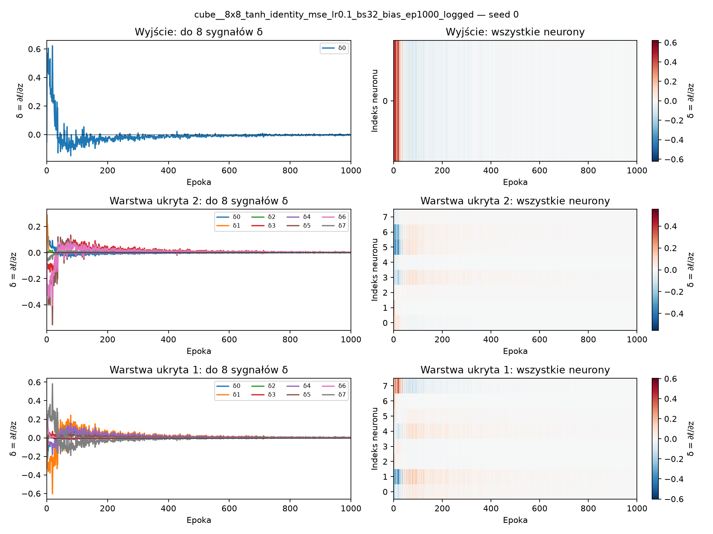
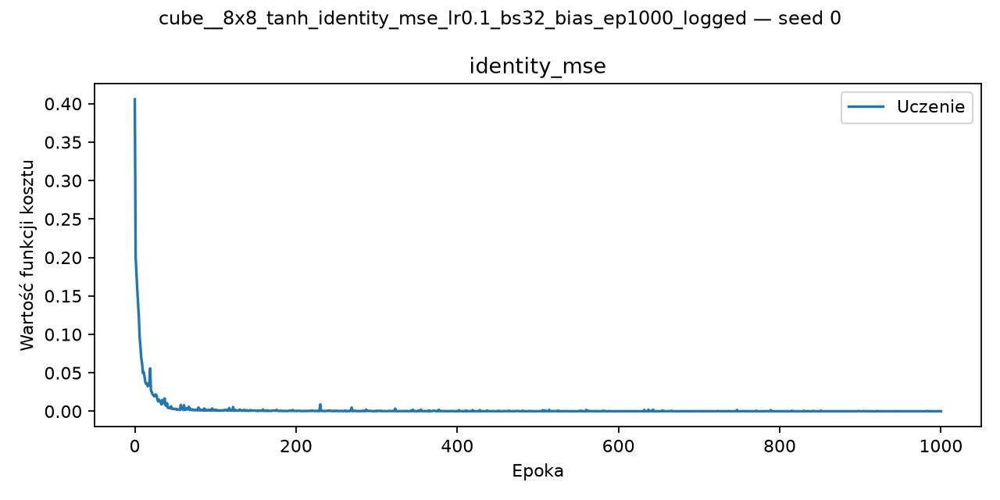
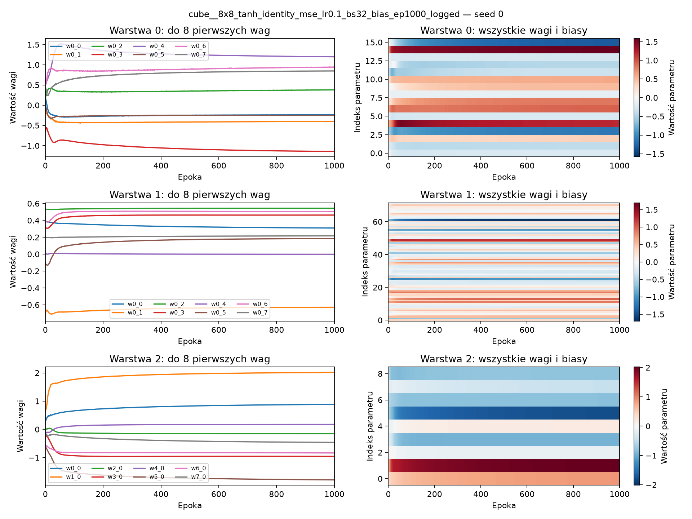

# cube__8x8_tanh_identity_mse_lr0.1_bs32_bias_ep1000_logged — seed 0

Dane i predykcje, propagowane sygnały δ, osobno koszt oraz wagi. Osie epok są liniowe.

δ = ∂ℓ/∂z: pochodna kosztu jednej próbki względem wejścia neuronu przed aktywacją. To nie wartość funkcji kosztu.

W każdej zapisanej epoce Rust ponownie wykonuje forward/backward na tej samej pierwszej próbce ze zbioru uczącego (pierwszy wiersz points_train.csv). Nie aktualizuje wtedy wag i nie używa testu.

Przepływ wstecz pokazano od góry: wyjście → kolejne warstwy ukryte. Mapy zawierają wszystkie neurony; każda warstwa ma własną skalę kolorów.

Koszt regresji dotyczy celu po normalizacji. Wagi są migawkami po epokach, nie po każdej partii SGD.

Na mapie wag każdy wiersz odpowiada jednej kolumnie pliku weights_layer*.csv, bez kolumny epoch.

## data_and_predictions.png

## backpropagation.png

## loss.png

## weights.png

