# Wyniki

Średnia ± odchylenie std po ziarnach. Rozbieżne runy (✗) są pominięte w średniej, lista w [failures.csv](failures.csv). Wybór lr na walidacji, raport na teście; regresja raportowana na części testu z zakresu uczenia (test_in_*), pełny test pokazuje ekstrapolację.

Tabele: [summary.csv](summary.csv), [runs.csv](runs.csv), [best.csv](best.csv).

**Nieudane runy: 2** (zob. failures.csv).

## simple: wpływ liczby warstw L i ich szerokości B

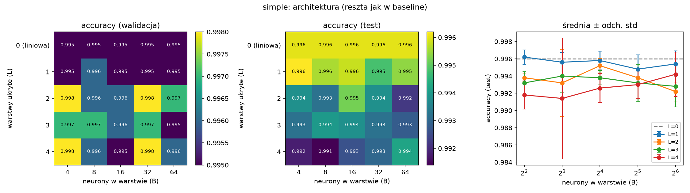

## simple: activation dla każdego lr (wybór lr na walidacji, raport na teście)

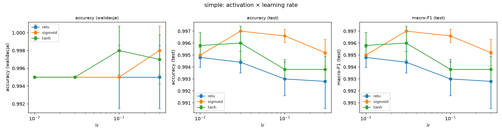

## simple: activation przy najlepszym lr każdego wariantu

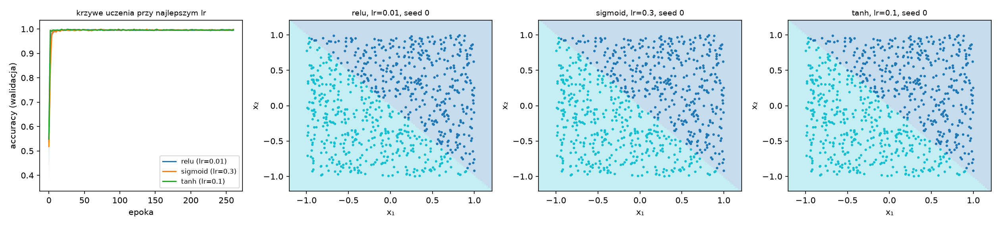

## simple: loss dla każdego lr (wybór lr na walidacji, raport na teście)

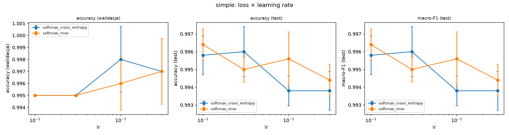

## simple: loss przy najlepszym lr każdego wariantu

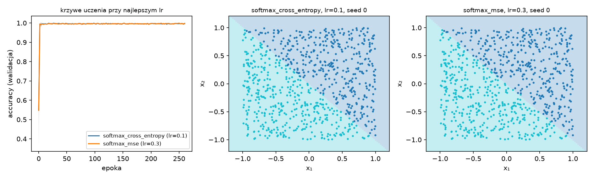

## simple: sieć z biasami i bez

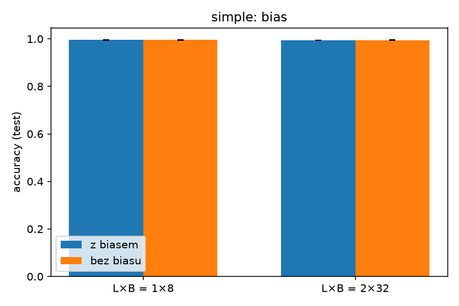

## simple: wpływ liczby przykładów uczących

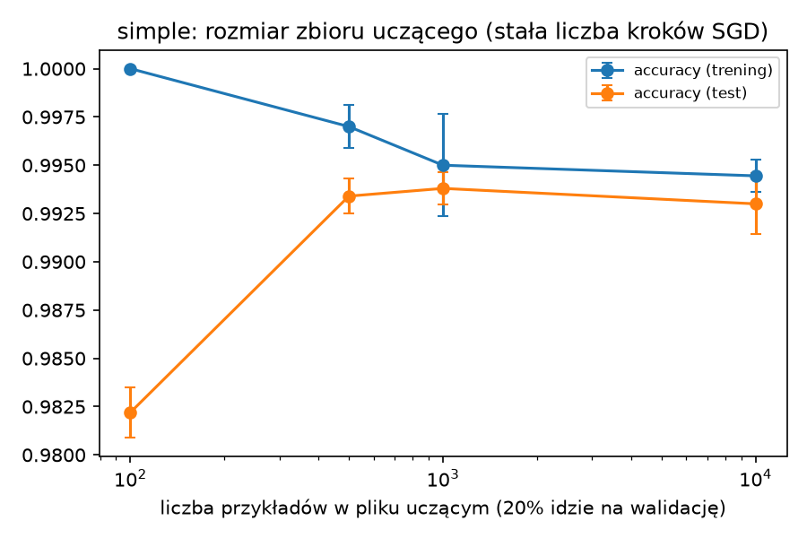

## three_gauss: wpływ liczby warstw L i ich szerokości B

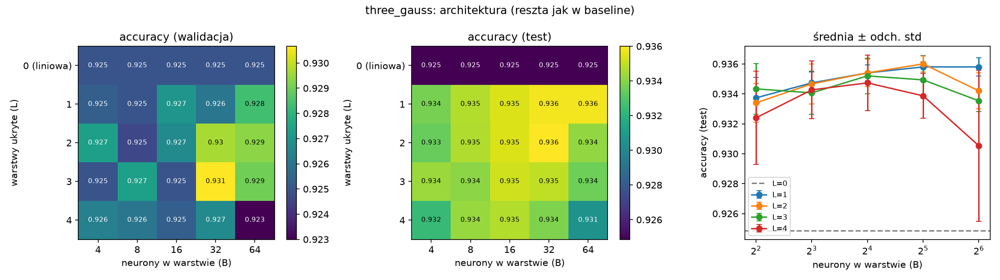

## three_gauss: activation dla każdego lr (wybór lr na walidacji, raport na teście)

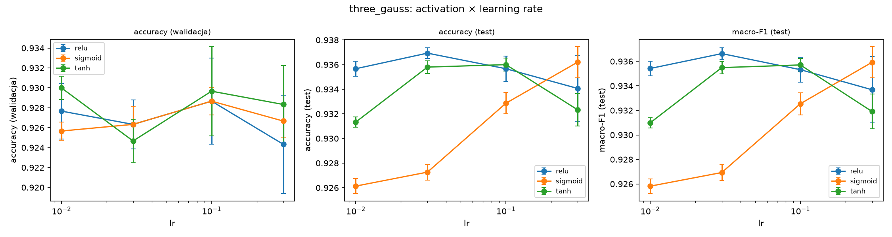

## three_gauss: activation przy najlepszym lr każdego wariantu

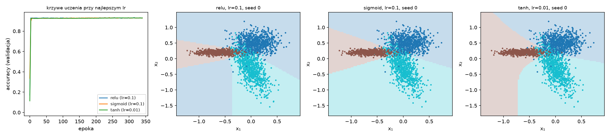

## three_gauss: loss dla każdego lr (wybór lr na walidacji, raport na teście)

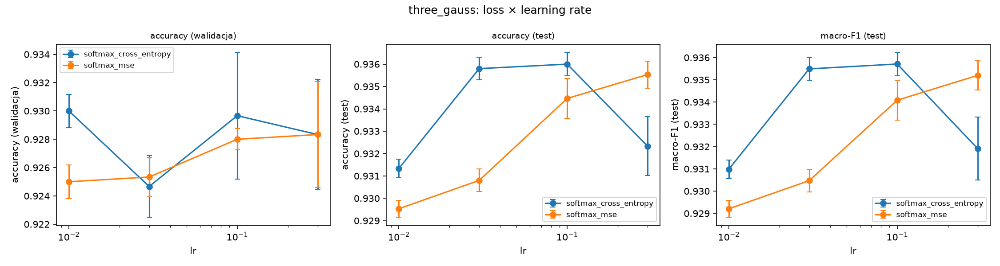

## three_gauss: loss przy najlepszym lr każdego wariantu

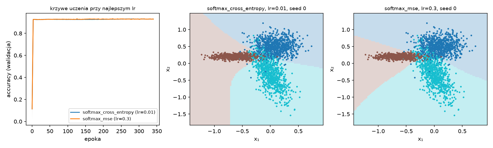

## three_gauss: sieć z biasami i bez

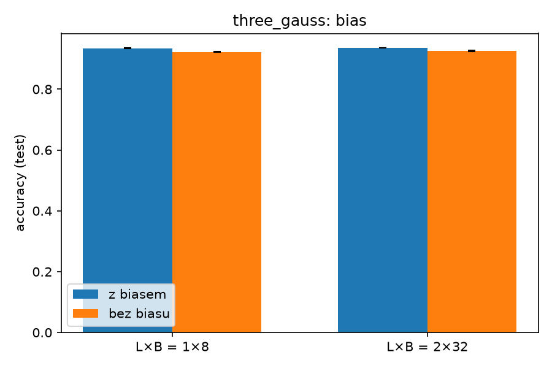

## three_gauss: wpływ liczby przykładów uczących

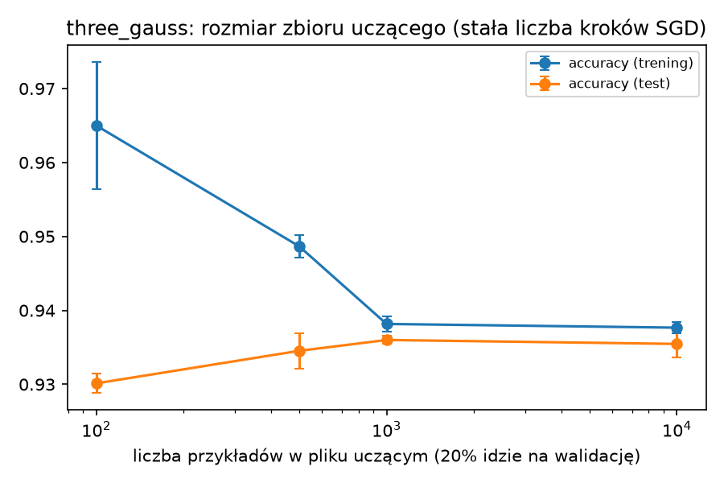

## cube: wpływ liczby warstw L i ich szerokości B

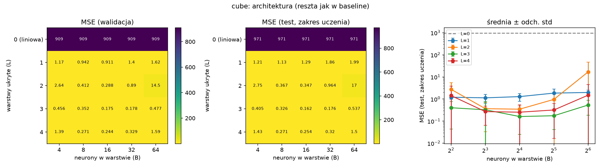

## cube: activation dla każdego lr (wybór lr na walidacji, raport na teście)

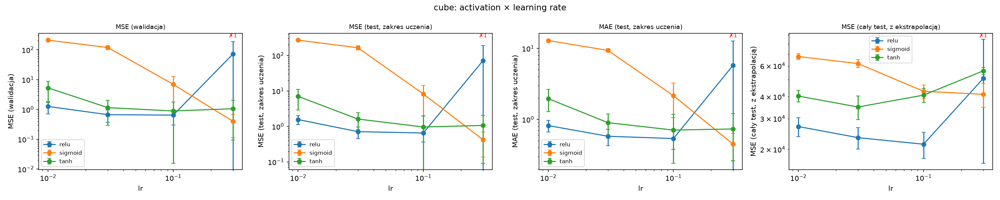

## cube: activation przy najlepszym lr każdego wariantu

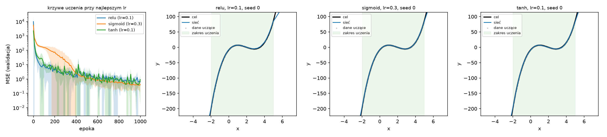

## cube: loss dla każdego lr (wybór lr na walidacji, raport na teście)

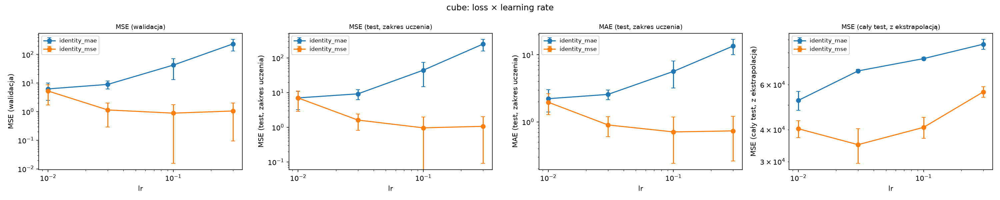

## cube: loss przy najlepszym lr każdego wariantu

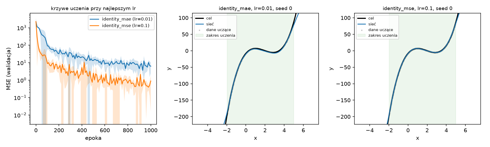

## cube: sieć z biasami i bez

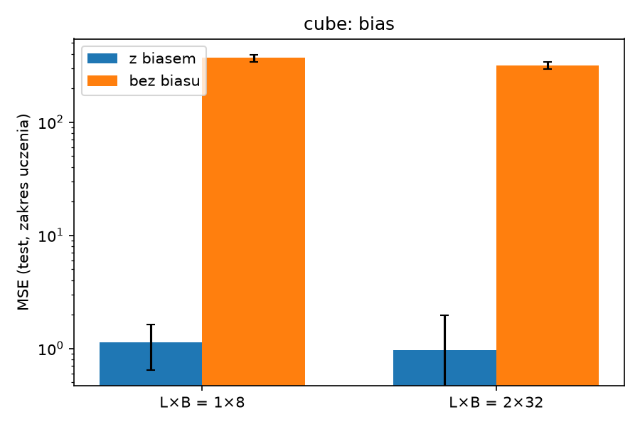

## cube: wpływ liczby przykładów uczących

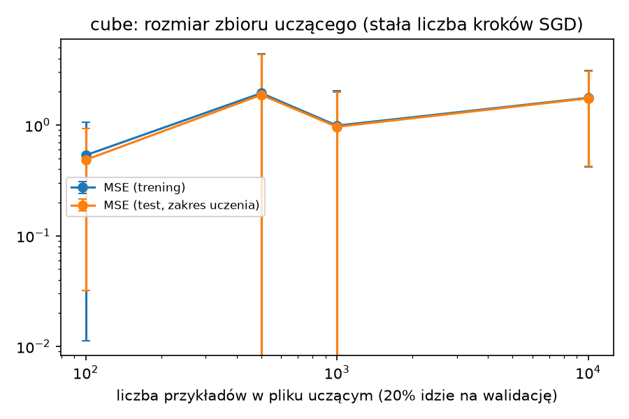

## activation: wpływ liczby warstw L i ich szerokości B

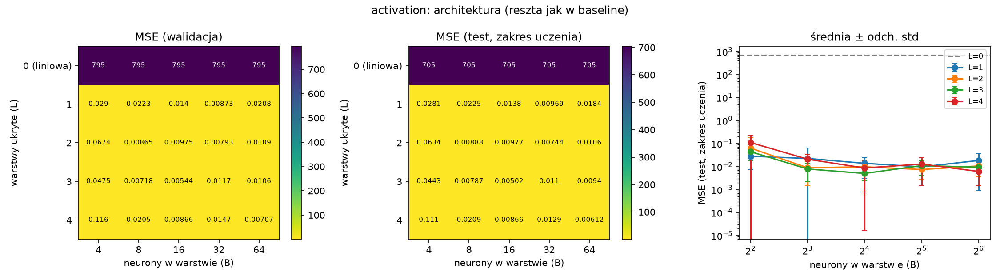

## activation: activation dla każdego lr (wybór lr na walidacji, raport na teście)

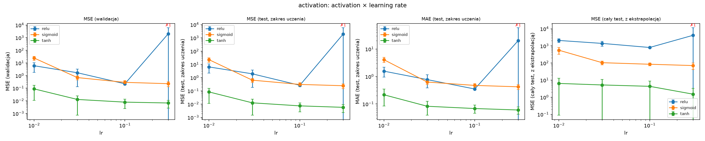

## activation: activation przy najlepszym lr każdego wariantu

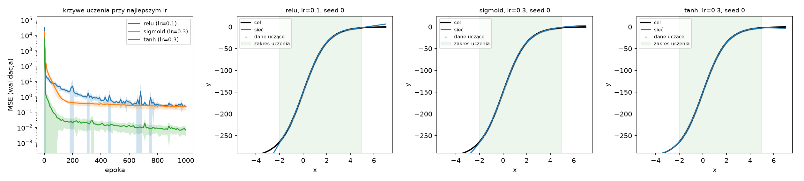

## activation: loss dla każdego lr (wybór lr na walidacji, raport na teście)

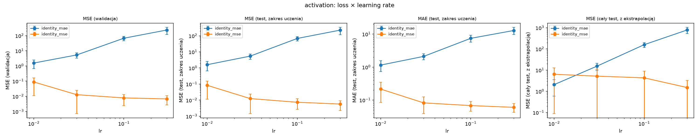

## activation: loss przy najlepszym lr każdego wariantu

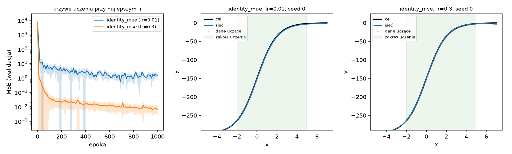

## activation: sieć z biasami i bez

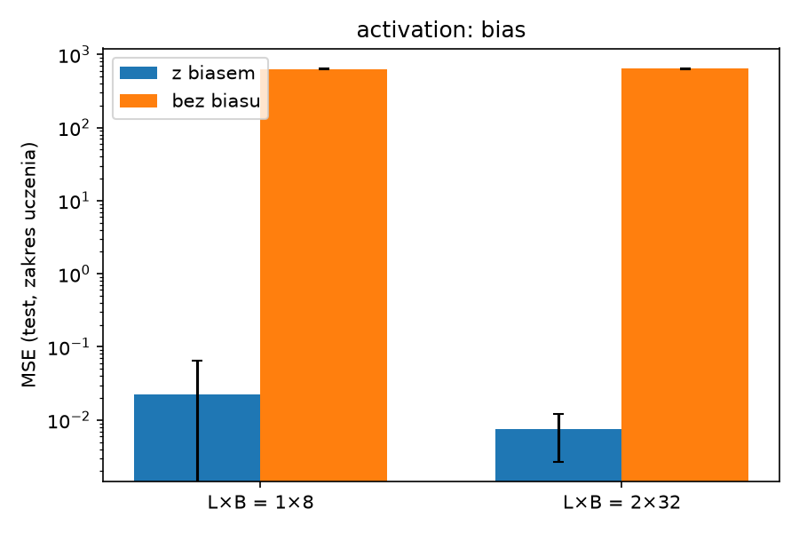

## activation: wpływ liczby przykładów uczących

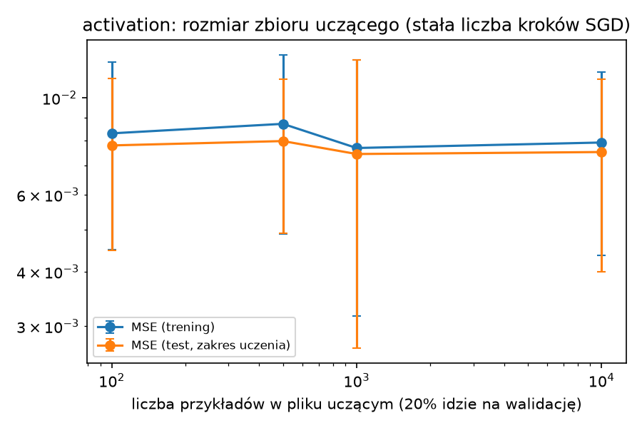

